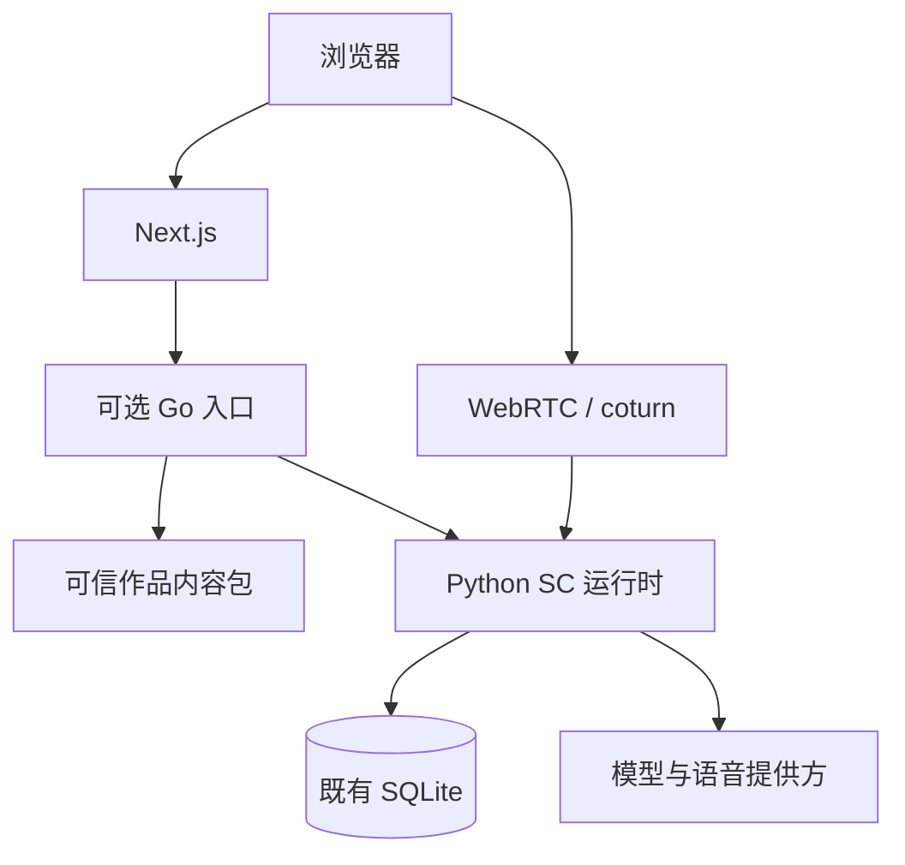

# 多作品 DLC 与 Go 迁移：仓库审查及第一批实现

后续验收：[2026-10-24 Mac Docker 工程验收](acceptance-2026-10-24.md)。下文的环境阻碍和测试结果保留为首次实现时的历史记录，最新结果以该验收报告为准。

审查基点：`3602e8d7`。工作分支：`refactor/multi-work-dlc`。本阶段选择“Go 作品目录 + 独立内容包 + SC 兼容入口”，不是全量后端迁移。默认生产 Compose、SC 配置及 SQLite 均未修改。

## 1. 实际架构与迁移判断

以下路径均相对仓库根目录，结论来自代码而非原项目简介。

| 领域 | 实际代码、数据流 | 迁移判断 |
|---|---|---|
| 应用装配和 HTTP | `backend/src/eidolon/assembly.py::build` 加载角色、世界设定、礼物目录，构造 Database、Store、模型客户端、检索、记忆、引擎及通话；`app.py::create_app` 注册主体路由，另挂 account/admin/gifts/photos 等路由模块 | 不能只按 URL 文件拆后端；大量路由依赖同一个 Backend 和事务域 |
| 文字对话 | `app.py` 的 conversations/turns → `engine.py::ConversationEngine`；先统一读历史、好感度、档案与资格，再触发记忆、检索/判断，组装系统人设、世界设定、历史及回合上下文，流式调用模型并处理工具，最后记录回合、好感度和奖励 | 以“完整回合及其事务”迁移；不可先拆好感度写入让两个进程补偿 |
| LLM 与外部能力 | `assembly.py`、`service_clients.py`、`own_keys.py`、`proxy.py` 等负责提供方选择、自带密钥、代理约束；`engine.py` 流式事件与工具调用直接影响前端/SSE 和语音 | 保留现有密钥隔离和失败不回退规则，迁移时需逐事件契约，不是简单改 HTTP SDK |
| 认证 | `identity.py` 实现 GitHub/Google 身份提供方；`accounts.py` 处理登录和封禁；`sessions.py` 校验 Origin、会话、封禁及同意条款（428）；`store.py` 保存 token_hash、用户和登录方式 | 账号是全局共享域，但现在迁移风险高，先保持唯一 Python 实现；Go 不自行信任用户 ID 请求头 |
| SQLite | `database.py::connect` 开 WAL、NORMAL、secure_delete 和外键，锁等待 30 秒；`data_access.py::Database` 单写连接在线程队列，4 条只读连接和线程池；回合/礼物等跨模块事务在同一写任务内 | 与 ADR-0028 一致：本阶段 Go 零连接、零迁移、零写入 |
| 角色 | `characters.py` 从 `characters.toml` 加载人设、资料、读音、媒体路径、生日、音色、礼物；`app.py` 目录含组合、立绘、招呼等派生字段；`in_idol_order` 保持原作顺序 | SC 的配置/展示规则继续单源；新包的通用身份、注册和目录直接用 Go |
| 世界设定 | `world.py` 读取同目录 `world.json`，含职员、组合、偶像、歌曲、唱片和演出；按角色与日期生成 prompt；声优不进入 prompt；世界资料又进入检索 | SC 世界逻辑含作品语义，暂不机械抽象。Go 新包先用独立文本世界设定 |
| 剧情导入/RAG | `story_sync.py`、`corpus.py`、`retrieval.py`、`references.py`、`embedding.py`；剧情含出场角色，候选由角色过滤；剧情、角色资料、作品资料检索后重排；SQLite 存向量，numpy 参与向量处理 | 当前只有单作品数据源，角色筛选不等于作品隔离；第二作品绝不能直接共用这些查询 |
| 记忆 | `memory.py` 的 memories/memory_vectors 以用户为共享范围，保留 character_id/conversation_id 来源；ADR-0002 允许 SC 角色互相转述 | 新作品上线前必须把记忆可见性收窄到用户 + 作品，连同提炼、向量缓存、删除、导入导出一起处理 |
| 玩法与历史 | `store.py` conversations 关联用户、裸角色 ID；messages/calls/photos 等关联 conversation；`affinity.py` 主键是 `(user_id, character_id)`；gift/daily_task/achievement/profile 等也有共享状态 | 不能只往 conversations 加 work_id：钱包、档案、任务、成就、触达、统计和数据包都要定作用域 |
| 语音 | `call.py` 直接组合 Pipecat Pipeline、帧处理器、RTVI、SmallWebRTC、Fish TTS、Soniox/百炼 STT、打断与回合状态；生产 coturn 与 Python 走 host 网络 | 长期保留 Python 语音合理。Go 入口仅转发 offer/PATCH 等信令，UDP 音频不经过 Go |
| 前端/部署 | `frontend/src/app/api/[...path]/route.ts` 转发请求流、Cookie、Origin、SSE；`lib/backend.ts` 用 BACKEND_URL 做服务端读取；开发 Compose 是内部网络，生产是 Caddy + Next + Python + coturn 的 host 网络 | 仅在本地选择 BACKEND_URL 接入 Go；现有页面继续走原 API，无需改造 UI；尚无作品切换界面 |
| 测试 | `backend/tests` 通过 `build_faked` 构建真实 Backend、临时 SQLite 和 ASGI app，外部模型/身份服务为 fake；前端用 Vitest；CI 跑 pytest/pyright/ruff、前端检查和镜像构建 | 沿用现有 fixture 增加跨语言测试；原测试套件仍是 SC 回归的主依据 |

## 2. 过渡依赖方向

Go 注册所有作品并处理新目录路由；只有 SC 目录适配器依赖 Python 的公开只读接口。其余旧路由原样代理，Python 不回调 Go，所以没有依赖环。Go 不读取 `.env`、OAuth 密钥、SC 人设或数据库；前端传来的业务密钥仍只随原请求流转，不被记录。CLI 仅接受固定配置的上游 HTTP origin，内部 transport 不使用环境代理。

全局身份为 `(work_id, local_id)`，在新 API 表示为 `work_id:local_id`。SC 旧 URL、头像路径、TOML、数据行中的裸 ID 原样保留。显式选择非 SC 后不能回退到 SC。

新增进程是过渡边界，不是每作品服务：所有 DLC 在一个 Go 进程加载，无消息队列、服务发现平台、第三方插件执行器或第二数据库。

## 3. 已实施与尚未实施

| 能力 | 归属与状态 |
|---|---|
| 作品发现、schema 校验、重复检测、默认作品及能力声明 | **Go 已实现**，`core/internal/catalog/catalog.go` |
| 新 DLC 角色目录、全局标识、世界设定 HTTP API | **Go 已实现**，`http.go`；内容源是独立 `work.json` |
| SC 新作用域目录 | **Go 适配已实现**；SC 配置解析和展示派生规则仍由 Python 执行 |
| 旧 API 兼容转发 | **Go 已实现**；保留状态码、Cookie/Origin、响应头与流式传输，不剥离认证 |
| SC 世界设定、人设、RAG、对话、记忆、玩法、认证、持久化、语音 | **Python 继续负责**；未迁移，旧行为没有重新实现 |
| DLC 对话、持久化、语音、RAG | **未启用**，作品路径请求明确失败，能力声明为不可用 |
| 学偶真实内容与作品选择 UI | **未实现**；当前只有虚构 demo 内容包 |

示例包 `core/testdata/packs/demo/work.json` 故意复用本地角色 ID `mano`；目录返回 `demo:mano`，SC 返回 `sc:mano`。DLC 世界设定不会调用 Python；SC 上游不可用时 DLC 目录仍可用。SC 人设没有公开目录接口，新 DLC 的 sheet 也不从公开目录输出。

`world` 是新包明示可公开的文字，不包含私密剧情资料。新包目前没有素材服务、facts 索引或音色能力字段；没有造出这些未实现的接口。

## 4. 数据兼容与未来迁移门槛

本阶段没有 ALTER TABLE、数据回填、修改旧主键或向量重建。Go 容器不挂载数据卷。所有写入、schema 初始化、删除、checkpoint、备份仍由 Python 完成。因而不会发生 Go/Python 双写，也没有本阶段的数据库回滚操作。**未对用户真实数据库执行迁移或恢复验证**；不能把“未碰数据”表述为已通过全部生产历史回归。

未来开放第二作品前，必须完成一个独立、可回滚的 schema 阶段：

1. 在临时库和生产库副本验证迁移；先备份，离线或明确停止写入。存量行确定回填 `sc`，保留旧角色 ID。
2. conversations 加作品身份；角色资料、剧情/出场角色/段落/向量及作品事实的所有唯一键与查询带作品域，避免只给最外层 API 加参数。
3. memories 及其向量/缓存限定 `(user_id, work_id)`；来自历史 conversation 的作品应一致。用户级记忆是否另设全局层必须单独决策，不能默认跨作品传播。
4. affinity 改为用户 + 作品 + 角色；制作人档案、礼物、余额、任务、成就、主动触达明确作品作用域，账号/登录方式/站点权限仍全局。限额是否按用户全局维持原反滥用语义。
5. 同步更新删除用户、删除对话、导入导出、统计、管理后台、备份恢复及向量重嵌入；无作品字段的旧数据包只认 SC。
6. 迁移责任仍只由一个实现承担。业务写入交给 Go 时，以整个事务域切换所有权；Python 通过窄 RPC 请求写入，不允许两套 DAO 同时更新同一状态。

RAG 在本阶段的明确范围是 **仅 SC 旧运行时**。新作品的 RAG 为 unavailable；测试只验证拒绝/不回退，不验证多作品召回正确性。后续必须用同名角色、同文档 ID、相同文本但不同作品的语料做越域负例，连同缓存键和 recall_story 工具测试。

## 5. 测试、性能与限制

本地实际执行：

- Go `go test -race -cover ./...` 通过，目录包语句覆盖率 **94.7%**（不含 CLI 覆盖）；包含内容包错误、同名角色隔离、SC 契约、上游故障、认证信息透传、显式非 SC 写入拒绝。
- Go 使用 `net.Pipe` 跑完整 HTTP framing 和 SSE，验证第一段在后续数据产生之前到达客户端，而非仅比较完整字符串。
- Go vet、本机二进制及 Linux amd64 静态二进制交叉构建通过；零第三方 Go 依赖。
- 单角色目录 microbenchmark（本机 Apple M5 / darwin arm64）：约 **2270 ns/op、7872 B/op、57 allocs/op**。包括测试请求/响应对象开销；不是网络吞吐、服务器 RSS 或 Azure 性能。

验证阻碍与未通过项：

- 本机禁止 TCP bind，真实 `httptest.NewServer` 测试执行失败，报 `operation not permitted`。该测试现以 `EIDOLON_TCP_TESTS=1` 显式启用，CI 必须执行；本地只运行无端口测试。
- 本机没有 uv/项目 Python 环境，尝试下载 uv 被网络权限拒绝。因此现有 pytest、ruff、pyright 及新 FastAPI 联调 **未在本机运行**，不能称为通过。
- 新增 `backend/tests/test_go_catalog.py`：真实 Go 进程 → 真实 Uvicorn/FastAPI → 临时 SQLite；验证完整 SC 目录相等、新目录隔离、历史读取不变、匿名仍 401；仅外部服务使用仓库既有 fake。CI backend job 构建 Go 并设置 `EIDOLON_CORE_BINARY` 强制启用。**尚未获得 CI 结果**。
- 没有实际运行 Next.js 构建版、Playwright、真实 OAuth/LLM 或 WebRTC 通话验收，也没有执行镜像构建与 1GB VPS 压测。生产配置保持不变，第一批改动还不能宣称满足全部上线验收。

资源预算：新增 Go 进程有额外 RSS 与一跳本地 HTTP；没有复制向量索引或角色媒体。只读内容包启动载入，每包上限 2 MiB；SC 目录请求上游超时 5 秒，响应上限 2 MiB；其他代理响应不加统一总时限，避免截断 SSE。overlay 设 GC 软目标 64 MiB、容器限额 96 MiB、GOMAXPROCS=2，仅为待验证预算；没有实测空闲/峰值 RSS。仍有很多内容包或并发请求时，内存可超出软目标。Go 故障会影响经过它的旧请求，应先完成联调、失败注入和回滚演练后再考虑上线。

## 6. 下一批优先级

1. **补齐实际联调与 SC 回归**：在允许监听、已安装依赖的环境执行 CI 命令，验证登录、文字 SSE、头像/招呼、WebRTC 信令、导出和流式取消，再测 2 核/1GB 的总 RSS。先验证入口再扩大迁移范围。
2. **SC 内容加载所有权转交 Go**：从现有 `characters.py`/`world.py` 明确区分通用格式与 SC 领域规则，建立稳定内容快照契约；用完整 SC golden fixtures 对比，然后让 Python 消费 Go 只读内容。不能同时保留两套持续演化的 TOML 解析/目录派生规则。此后删掉本阶段 SC 目录反向适配。
3. **作品域数据迁移与最小文字会话切片**：先落实上节 schema 门槛，再由 Go 接管完整文字对话事务/历史 API；必要时保留 Python RAG 计算服务，以必填 work_id 调用。每一切片都可单独回滚，切换前只有一个写者。
4. **记忆与 RAG**：Go 可实现远程 embedding/rerank 客户端及检索调度；numpy 检索的等价性、剧情导入语义、缓存淘汰和重嵌入成本单独验证。先保持模型/向量版本一致，避免迁移时重复保存两份索引。
5. **账号/权限与通用管理 API**：在会话 token、OAuth state、绑定、防封禁绕过、Origin、同意条款、删账号安全清理的契约完整后整域迁移。共享账号不等于可以提前拆两套会话验证。
6. **语音最后评估**：Pion 等 Go WebRTC 实现只解决传输的一部分；替换 Pipecat 还需重做 STT/TTS 帧管线、RTVI、打断、背压、VAD/回合切分、断线清理、音频时钟及取消。保留一个 Python 语音进程很可能更稳妥；未来通过明确回合协议调用 Go 引擎，语音进程不再拥有业务数据库写入。此次未做替代技术原型或声学性能对比，不给出工期保证。

## 7. 学偶接入与交付边界

按 `core/README.md` 创建 `work_id=gakumas` 的包即可注册角色和独立世界设定。角色 ID 可与 SC 重名；前端未来应始终携带全局 ID 或作品 + 本地 ID。素材、人设、音色、剧情导入器按作品组织，不能复用 SC 专属的组合、职员、演出推断规则。

保留根目录 AGPL 声明与原作者信息；发布网络服务修改版时提供对应源代码，原作素材授权另行处理。本阶段未接触 Azure、未推送 main，也没有访问任何 `.env`。由于 `.git` 在此环境只读，不能创建新分支/提交；所有改动留在原有独立开发分支的工作区，未推送或创建 PR。

当前交付是**已实现并通过本地 Go 检查、但跨语言端到端验收受环境限制尚未完成的第一切片**。应先补齐上述验证，再宣称阶段验收完成或上线。
